# Amazon SP-API Database Design & Production Architecture
**Virtual CFO Engine — Amazon Command Center (Audited & Production-Ready)**

---

## 📌 Executive Summary

This document presents the complete production architecture, database schema, and normalization rules for the **Amazon Command Center** within the Virtual CFO platform.

The system ingests raw data from **Amazon Selling Partner API (SP-API)**, stores original JSON payloads in a raw storage layer, normalizes records into **PostgreSQL relational tables**, executes currency conversions and CFO metric calculations, and exposes audit-proof financial metrics to the executive dashboard.

---

## ⚙️ 1. Centralized SP-API Versioning Configuration

All Amazon SP-API endpoints use a centralized configuration [`SP_API_VERSIONS`](file:///d:/Virtual-CFO/src/lib/sp-api-config.ts#L6-L19) defined in `src/lib/sp-api-config.ts`:

```typescript
export const SP_API_VERSIONS = {
  ORDERS: 'v2026-01-01',                  // Upgraded from v0
  FINANCES: 'v2024-06-19',                // Upgraded from v0
  CATALOG: 'v2022-04-01',
  PRODUCT_PRICING: 'v2022-05-01',
  PRODUCT_FEES: 'v0',
  REPORTS: 'v2021-06-30',
  FBA_INVENTORY: 'v1',
  FULFILLMENT_INBOUND: 'v2024-03-20',
  FULFILLMENT_OUTBOUND: 'v2020-07-01',
  LISTINGS_ITEMS: 'v2021-08-01',
  LISTINGS_RESTRICTIONS: 'v2021-08-01',
  PRODUCT_TYPE_DEFINITIONS: 'v2020-09-01'
} as const;
```

---

## 🏗️ 2. Architectural Flow

```mermaid
flowchart TD
    subgraph Amazon SP-APIs
        API_ORD[Orders API v2026-01-01]
        API_FIN[Finances API v2024-06-19]
        API_CAT[Catalog Items API v2022-04-01]
        API_INV[FBA Inventory API v1]
        API_PRC[Product Pricing API v2022-05-01]
        API_FEE[Product Fees API v0]
        API_REP[Reports API v2021-06-30]
        API_INB[Fulfillment Inbound API v2024-03-20]
        API_OUT[Fulfillment Outbound API v2020-07-01]
        API_LST[Listings Items API v2021-08-01]
        API_RST[Listings Restrictions API v2021-08-01]
        API_TYP[Product Type Definitions API v2020-09-01]
    end

    subgraph Raw Response Layer
        RAW[(amazon_raw_api_responses)]
    end

    subgraph Data Normalization Pipeline
        LWA[LWA OAuth Token Refresh]
        NORM[Relational Normalizer]
        FX_ENG[Currency / FX Conversion Engine]
        SYNC_LOG[Sync Tracker - amazon_sync_runs]
    end

    subgraph PostgreSQL Relational Tables
        TBL_ORD[(amazon_orders)]
        TBL_ITM[(amazon_order_items)]
        TBL_GRP[(amazon_financial_event_groups)]
        TBL_FIN[(amazon_financial_events)]
        TBL_SET[(amazon_settlements)]
        TBL_TRF[(amazon_transfers)]
        TBL_PRD[(amazon_products)]
        TBL_CST[(amazon_product_costs)]
        TBL_INV[(amazon_inventory)]
        TBL_PRC[(amazon_product_pricing)]
        TBL_FEE[(amazon_product_fee_estimates)]
        TBL_RFD[(amazon_refunds)]
        TBL_RET[(amazon_returns_reports)]
        TBL_INB[(amazon_inbound_shipments)]
        TBL_OUT[(amazon_outbound_fulfillment_orders)]
        TBL_HST[(amazon_listings_health)]
        TBL_RST[(amazon_listing_restrictions)]
        TBL_TYP[(amazon_product_type_definitions)]
        TBL_REP[(amazon_report_jobs)]
        TBL_MKT[(amazon_marketplaces)]
    end

    subgraph Virtual CFO Metrics Engine
        CFO_WAT[Waterfall Money Flow]
        CFO_INV[Inventory Cover & Reorder]
        CFO_MAR[Contribution Margin & Profitability]
        CFO_AUD[Disbursement & Payout Audit]
    end

    API_ORD & API_FIN & API_CAT & API_INV & API_PRC & API_FEE & API_REP & API_INB & API_OUT & API_LST & API_RST & API_TYP --> LWA --> RAW
    RAW --> NORM --> FX_ENG
    FX_ENG --> TBL_ORD & TBL_ITM & TBL_GRP & TBL_FIN & TBL_SET & TBL_TRF & TBL_PRD & TBL_CST & TBL_INV & TBL_PRC & TBL_FEE & TBL_RFD & TBL_RET & TBL_INB & TBL_OUT & TBL_HST & TBL_RST & TBL_TYP & TBL_REP & TBL_MKT
    
    TBL_ORD & TBL_FIN & TBL_GRP & TBL_SET & TBL_TRF & TBL_PRD & TBL_CST --> CFO_WAT & CFO_INV & CFO_MAR & CFO_AUD
```



---

## 🏛️ 3. Core Source-of-Truth & Accounting Rules

1. **Operational vs. Financial Truth**:
   - `amazon_orders` is strictly for **operational tracking** (`business_status`, shipment details, items ordered).
   - `amazon_orders.amazon_fees` and `amazon_orders.refund_amount` are derived summary cache fields.
   - **Authoritative accounting** is computed exclusively from `amazon_financial_events`, `amazon_refunds`, `amazon_financial_event_groups`, and `amazon_transfers`.

2. **Financial Hierarchy (Separation of Concerns)**:
   $$\text{Customer Sales} \longrightarrow \text{Financial Event Group} \longrightarrow \text{Settlement Batch} \longrightarrow \text{Bank Transfer/Payout} \longrightarrow \text{Cash Received}$$
   - `amazon_financial_event_groups`: Financial accounting period groups.
   - `amazon_financial_events`: Individual transaction/fee line items (Commission, FBA Fulfillment Fee, Storage, Refunds).
   - `amazon_settlements`: Settlement disbursement closing statement.
   - `amazon_transfers`: Actual bank deposit transfers (Seller Wallet / Wire transfers).

3. **Raw API Storage Layer (`amazon_raw_api_responses`)**:
   - Every raw SP-API response JSON is archived in `amazon_raw_api_responses` for audit trails, debugging, and future schema recovery without re-syncing.

4. **Product Cost Management (`amazon_product_costs`)**:
   - COGS, shipping, packaging, and warehouse costs are business/CFO inputs, stored in `amazon_product_costs`.
   - If no cost is configured for an SKU, the system explicitly reports **"COGS not configured"** instead of assuming zero.

5. **Multi-Currency & FX Engine**:
   - All monetary records preserve original currency (`original_amount`, `original_currency`).
   - Reporting currency conversions (`reporting_amount`, `reporting_currency`, `exchange_rate`, `exchange_rate_source`) are automatically calculated using the tenant's base reporting currency (e.g., INR, USD, GBP, EUR).

6. **Multi-Tenant & Multi-Connection Safety**:
   - Tables enforce `tenant_id` and `connection_id`.
   - All unique constraints are tenant + connection composite keys: `UNIQUE(tenant_id, connection_id, amazon_order_id)`.

---

## 🗄️ 4. PostgreSQL Relational Schemas

### 4.1 Marketplaces Reference Table (`amazon_marketplaces`)
```sql
CREATE TABLE IF NOT EXISTS amazon_marketplaces (
  id SERIAL PRIMARY KEY,
  marketplace_id VARCHAR(50) UNIQUE NOT NULL,
  marketplace_name VARCHAR(100) NOT NULL,
  country_code VARCHAR(10) NOT NULL,
  currency_code VARCHAR(10) NOT NULL,
  region VARCHAR(50) NOT NULL,
  amazon_domain VARCHAR(100) NOT NULL,
  timezone VARCHAR(50) DEFAULT 'UTC',
  is_active BOOLEAN DEFAULT TRUE,
  created_at TIMESTAMP DEFAULT CURRENT_TIMESTAMP,
  updated_at TIMESTAMP DEFAULT CURRENT_TIMESTAMP
);
```

### 4.2 Financial Hierarchy Tables
```sql
-- 1. Financial Event Groups
CREATE TABLE IF NOT EXISTS amazon_financial_event_groups (
  id SERIAL PRIMARY KEY,
  tenant_id INTEGER REFERENCES tenants(id) ON DELETE CASCADE,
  connection_id VARCHAR(100) DEFAULT 'default',
  financial_event_group_id VARCHAR(100) NOT NULL,
  processing_status VARCHAR(50) DEFAULT 'Open',
  fund_transfer_status VARCHAR(50) DEFAULT 'IN_PROGRESS',
  original_total_amount DECIMAL(15, 2) DEFAULT 0,
  original_currency VARCHAR(10) DEFAULT 'INR',
  reporting_total_amount DECIMAL(15, 2) DEFAULT 0,
  reporting_currency VARCHAR(10) DEFAULT 'INR',
  start_date TIMESTAMP,
  end_date TIMESTAMP,
  trace_id VARCHAR(100),
  created_at TIMESTAMP DEFAULT CURRENT_TIMESTAMP,
  updated_at TIMESTAMP DEFAULT CURRENT_TIMESTAMP,
  UNIQUE(tenant_id, connection_id, financial_event_group_id)
);

-- 2. Settlements
CREATE TABLE IF NOT EXISTS amazon_settlements (
  id SERIAL PRIMARY KEY,
  tenant_id INTEGER REFERENCES tenants(id) ON DELETE CASCADE,
  connection_id VARCHAR(100) DEFAULT 'default',
  financial_event_group_id VARCHAR(100) NOT NULL,
  settlement_id VARCHAR(100),
  processing_status VARCHAR(50) DEFAULT 'Closed',
  fund_transfer_status VARCHAR(50) DEFAULT 'SUCCESS',
  original_total_amount DECIMAL(15, 2) DEFAULT 0,
  currency VARCHAR(10) DEFAULT 'INR',
  reporting_total_amount DECIMAL(15, 2) DEFAULT 0,
  reporting_currency VARCHAR(10) DEFAULT 'INR',
  start_date TIMESTAMP,
  end_date TIMESTAMP,
  deposit_date TIMESTAMP,
  account_tail VARCHAR(10),
  trace_id VARCHAR(100),
  created_at TIMESTAMP DEFAULT CURRENT_TIMESTAMP,
  updated_at TIMESTAMP DEFAULT CURRENT_TIMESTAMP,
  UNIQUE(tenant_id, financial_event_group_id)
);

-- 3. Transfers / Bank Deposits
CREATE TABLE IF NOT EXISTS amazon_transfers (
  id SERIAL PRIMARY KEY,
  tenant_id INTEGER REFERENCES tenants(id) ON DELETE CASCADE,
  connection_id VARCHAR(100) DEFAULT 'default',
  transfer_id VARCHAR(100) NOT NULL,
  settlement_id VARCHAR(100),
  financial_event_group_id VARCHAR(100),
  amount DECIMAL(15, 2) DEFAULT 0,
  currency VARCHAR(10) DEFAULT 'INR',
  reporting_amount DECIMAL(15, 2) DEFAULT 0,
  reporting_currency VARCHAR(10) DEFAULT 'INR',
  transfer_status VARCHAR(50) DEFAULT 'SUCCESS',
  transfer_date TIMESTAMP,
  destination_account_reference TEXT,
  created_at TIMESTAMP DEFAULT CURRENT_TIMESTAMP,
  updated_at TIMESTAMP DEFAULT CURRENT_TIMESTAMP,
  UNIQUE(tenant_id, connection_id, transfer_id)
);
```

### 4.3 Raw API Responses Storage (`amazon_raw_api_responses`)
```sql
CREATE TABLE IF NOT EXISTS amazon_raw_api_responses (
  id SERIAL PRIMARY KEY,
  tenant_id INTEGER REFERENCES tenants(id) ON DELETE CASCADE,
  connection_id VARCHAR(100) DEFAULT 'default',
  api_name VARCHAR(100) NOT NULL,
  api_version VARCHAR(50) NOT NULL,
  endpoint TEXT,
  http_method VARCHAR(10) DEFAULT 'GET',
  request_hash VARCHAR(64),
  amazon_resource_id VARCHAR(100),
  marketplace_id VARCHAR(50),
  response_json JSONB NOT NULL,
  response_status INTEGER DEFAULT 200,
  fetched_at TIMESTAMP DEFAULT CURRENT_TIMESTAMP,
  created_at TIMESTAMP DEFAULT CURRENT_TIMESTAMP
);
CREATE INDEX IF NOT EXISTS idx_amazon_raw_api_res ON amazon_raw_api_responses(tenant_id, connection_id, api_name, amazon_resource_id);
```

### 4.4 Dedicated Product Cost Inputs (`amazon_product_costs`)
```sql
CREATE TABLE IF NOT EXISTS amazon_product_costs (
  id SERIAL PRIMARY KEY,
  tenant_id INTEGER REFERENCES tenants(id) ON DELETE CASCADE,
  marketplace_id VARCHAR(50) DEFAULT 'A21TJRUUN4KGV',
  sku VARCHAR(100) NOT NULL,
  asin VARCHAR(50),
  cost_type VARCHAR(50) NOT NULL,                 -- COGS, SHIPPING, PACKAGING, WAREHOUSE, OTHER
  amount DECIMAL(12, 2) NOT NULL,
  currency VARCHAR(10) DEFAULT 'INR',
  effective_from TIMESTAMP DEFAULT CURRENT_TIMESTAMP,
  effective_to TIMESTAMP,
  source VARCHAR(100) DEFAULT 'CFO_CONFIG',
  created_at TIMESTAMP DEFAULT CURRENT_TIMESTAMP,
  updated_at TIMESTAMP DEFAULT CURRENT_TIMESTAMP,
  UNIQUE(tenant_id, sku, cost_type, effective_from)
);
```

### 4.5 Pipeline Sync Audit Tracker (`amazon_sync_runs`)
```sql
CREATE TABLE IF NOT EXISTS amazon_sync_runs (
  id SERIAL PRIMARY KEY,
  tenant_id INTEGER REFERENCES tenants(id) ON DELETE CASCADE,
  connection_id VARCHAR(100) DEFAULT 'default',
  api_name VARCHAR(100) NOT NULL,
  started_at TIMESTAMP DEFAULT CURRENT_TIMESTAMP,
  completed_at TIMESTAMP,
  records_fetched INTEGER DEFAULT 0,
  records_inserted INTEGER DEFAULT 0,
  records_updated INTEGER DEFAULT 0,
  records_failed INTEGER DEFAULT 0,
  retry_count INTEGER DEFAULT 0,
  status VARCHAR(50) DEFAULT 'Healthy',
  error TEXT,
  created_at TIMESTAMP DEFAULT CURRENT_TIMESTAMP,
  updated_at TIMESTAMP DEFAULT CURRENT_TIMESTAMP
);
```

---

## 📈 5. Metric Formulas & Anti-Double-Counting Matrix

```
Gross Principal Sales
  - Promotional Discounts
  - Tax
  - Actual Refunds (amazon_refunds)
─────────────────────────────────────────────
= Net Sales

Net Sales
  - Amazon Commissions (amazon_financial_events)
  - FBA Fulfillment Fees (amazon_financial_events)
  - FBA Storage & Service Fees (amazon_financial_events)
  - Unit COGS (amazon_product_costs)
  - Shipping & Packaging Costs (amazon_product_costs)
─────────────────────────────────────────────
= Contribution Profit

Separately Cash Flow Accounting:
Financial Event Group Total ──> Settlement Amount ──> Transfer Deposit ──> Bank Cash Received
```

---

## 🛠️ Summary Matrix of 23 Audited Modules

| Module # | Feature Area | SP-API Version Config | Primary PostgreSQL Table |
| :--- | :--- | :--- | :--- |
| **1** | Orders & Items | `v2026-01-01` | `amazon_orders`, `amazon_order_items` |
| **2** | Catalog Items | `v2022-04-01` | `amazon_products` |
| **3** | Financial Events & Waterfall | `v2024-06-19` | `amazon_financial_events`, `amazon_waterfall_summary` |
| **4** | Financial Groups & Transfers | `v2024-06-19` | `amazon_financial_event_groups`, `amazon_transfers` |
| **5** | FBA Inventory & Cover | `v1` | `amazon_inventory`, `amazon_inventory_alerts` |
| **6** | Sales Time-Series | Sales API `/sales/v1/orderMetrics` | `amazon_sales_metrics` |
| **7** | Marketplace Reference | ISO Marketplaces Config | `amazon_marketplaces` |
| **8** | Operational Business Status| `v2026-01-01` | `amazon_orders` (`business_status`) |
| **9** | Monetary Refunds | `v2024-06-19` | `amazon_refunds` |
| **10**| Physical Returns Reports | `v2021-06-30` (`GET_FBA_FULFILLMENT_CUSTOMER_RETURNS_DATA`)| `amazon_returns_reports` |
| **11**| Sales Rank (BSR) | `v2022-04-01` | `amazon_products` (`sales_rank`) |
| **12**| Competitive Pricing | `v2022-05-01` | `amazon_product_pricing` |
| **13**| Pre-Sale Fee Estimates | `v0` | `amazon_product_fee_estimates` |
| **14**| Settlements & Cash | `v2024-06-19` | `amazon_settlements` |
| **15**| FBA Inbound Shipments | `v2024-03-20` | `amazon_inbound_shipments` |
| **16**| MCF Outbound Orders | `v2020-07-01` | `amazon_outbound_fulfillment_orders` |
| **17**| Listing Health & Issues | `v2021-08-01` | `amazon_listings_health` |
| **18**| Product Restrictions | `v2021-08-01` | `amazon_listing_restrictions` |
| **19**| Reports Engine | `v2021-06-30` | `amazon_report_jobs` |
| **20**| Combined Listing Details | Joined Query | Joined View Query `product_listing_details_joined` |
| **21**| Product Type Schemas | `v2020-09-01` | `amazon_product_type_definitions` |
| **22**| Live Developer Inspector | Developer API Route | `/api/amazon/raw-data` & `/developer-amazon` |
| **23**| Pipeline Sync Tracking | Direct Logger | `amazon_sync_runs` |

---

*Document compiled and verified for Virtual CFO Platform Production Architecture.*
