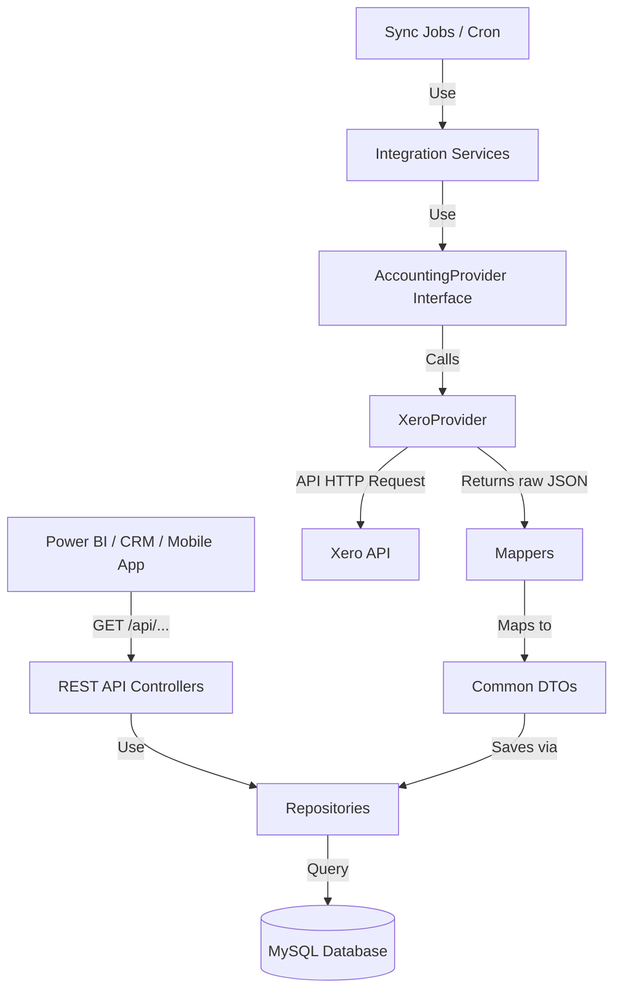

# Integration Platform Implementation Plan

This implementation plan details the architecture and step-by-step setup of a production-ready, modular integration platform using Laravel 10/11, MySQL, and Redis. It establishes a solid foundation for integrating Xero, with a structure that is easily extendable to QuickBooks, Zoho Books, or other accounting providers.

---

## Architecture Design

The platform uses a layered, SOLID-based architecture:
1. **API Layer**: Standardized controllers returning uniform JSON responses.
2. **Service Layer**: Handles business logic, including data synchronization and domain logic.
3. **Repository Layer**: Separates database persistence logic from business logic.
4. **Integration Layer**: Handles direct vendor communications (OAuth, fetching API payloads).
   - `AccountingProvider` (Interface)
   - `XeroProvider` (Implements `AccountingProvider`)
   - `Mappers` (Translates vendor-specific API structures into common Internal DTO structures)
   - `OAuthManager` / `XeroOAuthService` (Manages token lifecycles and scopes)
5. **Job & Schedule Layer**: Runs asynchronous sync processes and handles cron jobs.



---

## User Review Required

> [!IMPORTANT]
> **Authentication Flow Strategy**:
> - We will implement a multi-tenant OAuth2 flow. Each tenant (company) registers their Xero integration.
> - The application will provide an authorization URL. When the tenant admin completes the OAuth handshake, Xero redirects back to our callback route `GET /oauth/xero/callback` with a `code` and a `state` (carrying tenant context).
> - We exchange the code for access/refresh tokens and retrieve the list of accessible tenants (organizations) from the Xero Connections endpoint.
> - We store these credentials in `tenant_credentials` and default the tenant context.

> [!TIP]
> **Token Expiry & Automatic Refresh**:
> - We check token expiration before any provider API call. If a token is expired (or expires within 5 minutes), we automatically run a refresh token request, update the encrypted credentials in the database, and proceed with the API call transparently.

---

## Open Questions

None at this stage. Please review the proposed changes below.

---

## Proposed Changes

We will build the application incrementally using Laravel.

### 1. Project Initialization & Dependencies

#### [NEW] [composer.json](file:///c:/Users/hp/Documents/Xero-Connector/composer.json)
Initialize standard Laravel application. We will install:
- Standard Laravel framework.
- `league/oauth2-client` (optional, or we can use Laravel's native HTTP client `Illuminate\Support\Facades\Http` for custom-built, lightweight OAuth control). We will use native HTTP client to ensure it's easy to maintain, lightweight, and fully customized.

---

### 2. Database Design & Models

#### [NEW] [Migration: tenants](file:///c:/Users/hp/Documents/Xero-Connector/database/migrations/create_tenants_table.php)
Stores integration platform accounts (tenants).
```sql
CREATE TABLE tenants (
    id BIGINT UNSIGNED AUTO_INCREMENT PRIMARY KEY,
    name VARCHAR(255) NOT NULL,
    created_at TIMESTAMP NULL,
    updated_at TIMESTAMP NULL
);
```

#### [NEW] [Migration: tenant_credentials](file:///c:/Users/hp/Documents/Xero-Connector/database/migrations/create_tenant_credentials_table.php)
Stores OAuth details per provider and tenant.
```sql
CREATE TABLE tenant_credentials (
    id BIGINT UNSIGNED AUTO_INCREMENT PRIMARY KEY,
    tenant_id BIGINT UNSIGNED NOT NULL,
    provider VARCHAR(50) NOT NULL, -- 'xero', 'quickbooks', etc.
    tenant_identifier VARCHAR(255) NULL, -- Xero Organization / Tenant ID
    access_token TEXT NOT NULL, -- Encrypted
    refresh_token TEXT NOT NULL, -- Encrypted
    expires_at DATETIME NOT NULL,
    scopes JSON NULL,
    created_at TIMESTAMP NULL,
    updated_at TIMESTAMP NULL,
    FOREIGN KEY (tenant_id) REFERENCES tenants(id) ON DELETE CASCADE
);
```

#### [NEW] [Migrations: synced tables](file:///c:/Users/hp/Documents/Xero-Connector/database/migrations/create_synced_tables.php)
Includes schemas for local data caching/storage:
- `contacts` (includes customers)
- `invoices`
- `payments`
- `accounts`

---

### 3. Modular Integration Components

#### [NEW] [AccountingProvider.php](file:///c:/Users/hp/Documents/Xero-Connector/app/Integrations/Contracts/AccountingProvider.php)
The core contract that abstract providers must implement.
```php
namespace App\Integrations\Contracts;

use App\Integrations\DTOs\CustomerDTO;
use App\Integrations\DTOs\InvoiceDTO;
use App\Integrations\DTOs\PaymentDTO;
use App\Integrations\DTOs\AccountDTO;
use App\Integrations\DTOs\ProfitLossReportDTO;
use App\Models\TenantCredential;

interface AccountingProvider
{
    public function getCustomers(TenantCredential $credential): array;
    public function getInvoices(TenantCredential $credential): array;
    public function getPayments(TenantCredential $credential): array;
    public function getAccounts(TenantCredential $credential): array;
    public function getProfitLossReport(TenantCredential $credential, string $startDate, string $endDate): ProfitLossReportDTO;
}
```

#### [NEW] [XeroProvider.php](file:///c:/Users/hp/Documents/Xero-Connector/app/Integrations/Providers/XeroProvider.php)
Implements `AccountingProvider` specifically for Xero. Communicates via REST requests and performs JSON mapping.

#### [NEW] [Mappers](file:///c:/Users/hp/Documents/Xero-Connector/app/Integrations/Mappers/)
Mappers to convert vendor API payloads into standardized DTOs:
- `CustomerMapper.php`
- `InvoiceMapper.php`
- `PaymentMapper.php`
- `AccountMapper.php`

#### [NEW] [OAuthManager.php](file:///c:/Users/hp/Documents/Xero-Connector/app/Integrations/OAuth/OAuthManager.php)
Handles token generation, expiration checks, and token refreshing for all registered providers.

---

### 4. Service & Repository Pattern

We decouple database logic from controllers:
- **Repositories**: `CustomerRepository`, `InvoiceRepository`, `PaymentRepository`, `AccountRepository`.
- **Services**: Coordinate synchronization from provider DTOs into repositories.

#### [NEW] [Sync Service](file:///c:/Users/hp/Documents/Xero-Connector/app/Integrations/Services/SyncService.php)
Coordinates pulling from the appropriate provider and saving via repositories.

---

### 5. API Controllers & Routing

#### [NEW] [Controllers](file:///c:/Users/hp/Documents/Xero-Connector/app/Http/Controllers/Api/v1/)
Handles REST API requests:
- `CustomerController.php`
- `InvoiceController.php`
- `PaymentController.php`
- `AccountController.php`
- `ReportController.php`

#### [NEW] [TenantContextMiddleware.php](file:///c:/Users/hp/Documents/Xero-Connector/app/Http/Middleware/TenantContextMiddleware.php)
Injects tenant workspace context dynamically based on incoming headers (e.g. `X-Tenant-ID`).

---

### 6. Queue & Scheduling Jobs

#### [NEW] [SyncProviderDataJob.php](file:///c:/Users/hp/Documents/Xero-Connector/app/Jobs/SyncProviderDataJob.php)
Job to sync database with a provider asynchronously in the background.

#### [NEW] [Console/Kernel.php](file:///c:/Users/hp/Documents/Xero-Connector/app/Console/Kernel.php)
Schedules sync jobs to run periodically (e.g., hourly).

---

## Verification Plan

### Automated Tests
We will build tests to verify:
1. **OAuth Flow & Token Expiry Refresher**: Unit tests for `OAuthManager` with mock token requests.
2. **Mappers**: Unit tests checking that custom Xero JSON payloads are mapped correctly to standardized DTOs.
3. **Sync Jobs**: Verification of local database persistence using Laravel's database transaction tests.

### Manual Verification
1. Run MySQL migrations and verify DB structure.
2. Trigger the sync command manually via `artisan` console and check populated tables.
3. Call standard REST endpoints (`GET /api/customers`, etc.) via `curl` or Postman and ensure correct schema.
